# Gavran user guide

Gavran is the farm book for a Desi backyard flock. This guide matches the Help screen in the program. Each screen says what it is, where to find it, why it is there, and how to use it.

Hindi and Marathi words still need a person who speaks them well to check the wording. The name Gavran stays in Latin letters.

Open the program, sign in, and tap the farm name. The first visit starts a short tour. An owner, a manager, and a worker each see only their own tiles. Eggs, Flocks, Incubator machines, and Sick birds and medicines explain themselves once. Tap **Explain this screen** there, or **Show me around** on Help, to play a tour again.

## Sample farm on your computer

`npm run db:seed:demo` fills one local farm. It refuses to run when `NODE_ENV` is `production`. Run it again and it keeps the same farm. Every sample row is marked Sample.

| Who | Sign in |
|---|---|
| Owner | `admin@gmail.com` and `admin@123` (choose **I am the owner**) |
| Manager | `meera.demo@gmail.com` and `manager-demo-1` |
| Worker Lata | mobile `9811100011`, PIN `2468` |
| Worker Raju | mobile `9811100022`, PIN `1357` |

The owner password is short only for this demo account. A new account still needs 10 characters. The same steps are in `docs/WINDOWS_SETUP.md`.

## Sign in

A worker signs in with the mobile number and the PIN the owner set. The number keys are large. Spaces in the number are ignored. The PIN is four to six digits.

The owner signs in with a mail address and a long secret phrase. On the sign-in screen, choose **I am the owner**.

Nothing is sent to the worker. The owner says the PIN out loud or writes it down. The owner or a manager can set a new PIN. The old PIN stops working, and that person is signed out. After five wrong tries, sign-in waits.

## Ports on your computer

Copy `.env.example` to `.env` before the first start. The sample is:

- `CLIENT_PORT=5317` — the program in the browser
- `PORT=5318` — the API. The browser program sends `/api` to this port
- `MYSQL_PORT=3317` and `DB_PORT=3317` — MySQL on this computer
- `CORS_ORIGIN=http://127.0.0.1:5317`

These are not 4317, 4318, or 3307, because Cursor on the owner's Windows PC already forwards those ports. The steps are in `docs/WINDOWS_SETUP.md`. Automated tests still use database port 3307.

## Home

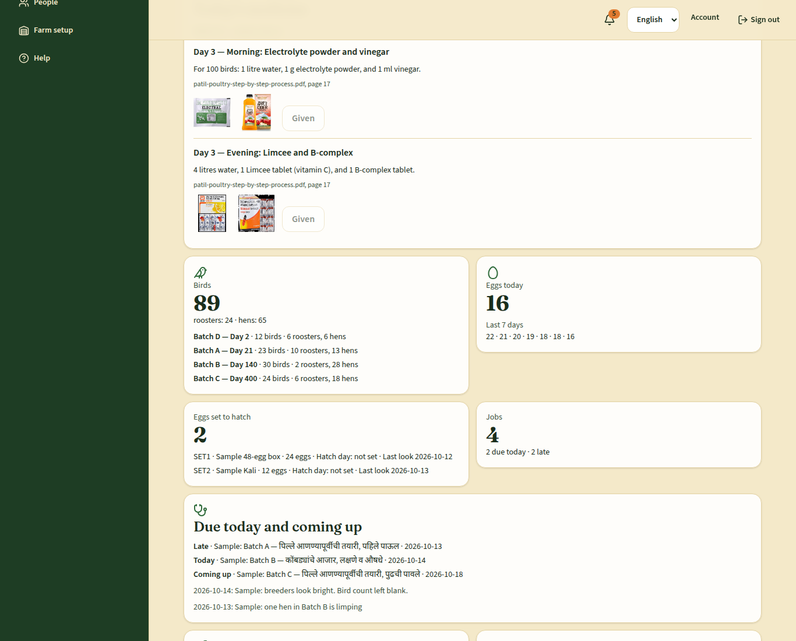

**What it is.** The first screen after you open a farm. Cards show birds, roosters and hens, each flock's age in days, eggs, eggs set to hatch, jobs, care days, feed, and money. A coloured band lists late jobs, care that is due, and low feed. Tiles for the main jobs sit under the cards.

**Where it is.** Tap the farm name on the farm list. The bell at the top opens the same coloured band.

**Why it is used.** So you see today's farm before you open a long menu. A worker does not see the money card.

**How to use it.**

1. Read the coloured band. Tap a line to open that page.
2. Tap a card to open flocks, eggs, hatch sets, jobs, care, feed, or sales.
3. Tap **Tell me on this phone** if you want this browser to show a notice. The page always answers. On this computer, `http://127.0.0.1:5317` can ask. A phone on a plain `http://192.168…` address cannot. Set `HTTPS=1`, start again, and open the `https://` address on the phone (see the Windows setup notes). The program asks first. It does not send a notice overnight. If notices are blocked or the list is empty, the page says that, and the coloured band is still the list.
4. When you write the medicine for a care day you set, that job is marked done.
5. Tap a tile under the cards. A tile with one job opens that job. A tile with many jobs opens those jobs.

## Today

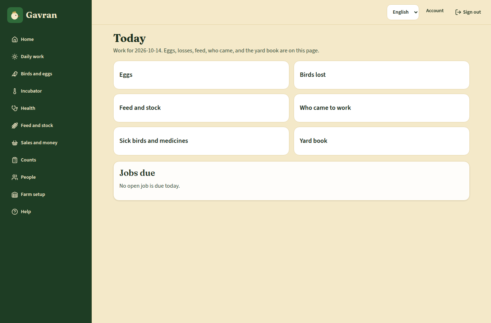

**What it is.** Jobs due today and shortcuts to eggs, losses, feed, who came, health, and the yard book.

**Where it is.** Daily work, then Today. Also the sun icon on a phone.

**Why it is used.** So the morning starts in one place.

**How to use it.**

1. Read the jobs that are due.
2. Tap a shortcut to write eggs, a loss, feed, who came, health, or the yard book.

## Yard book

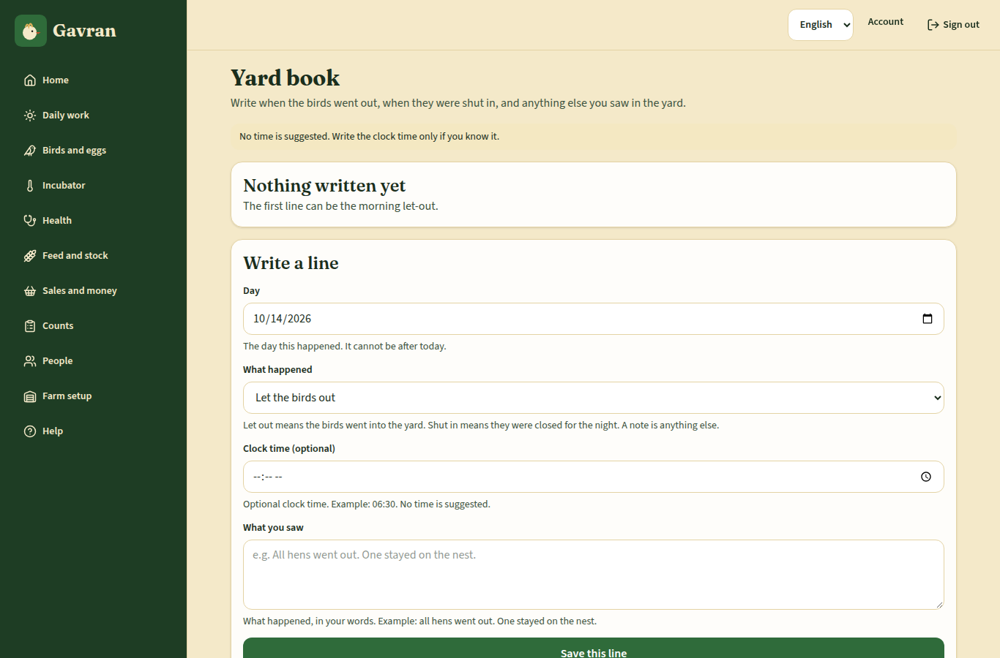

**What it is.** A notebook for the yard: when the birds went out, when they were shut in, and anything else you saw.

**Where it is.** Daily work, then Yard book. Today also links here.

**Why it is used.** So the morning and the night have a written time, and a note stays with the farm.

**How to use it.**

1. Pick the day.
2. Choose Let the birds out, Shut the birds in, or A note.
3. Type a clock time if you know it, and a short line about what happened.
4. Save the line.

## Jobs

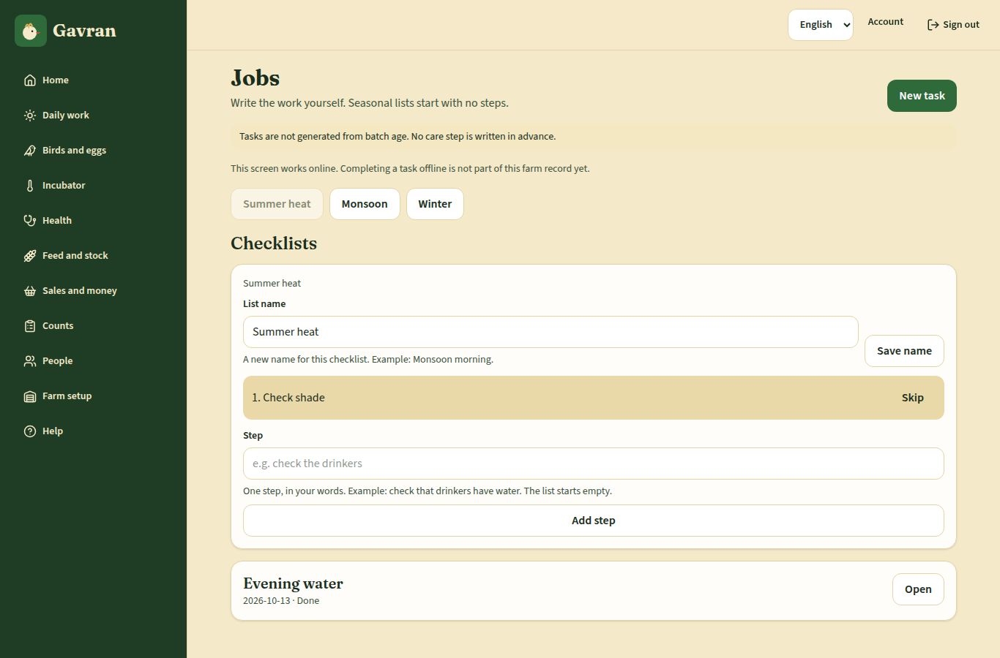

**What it is.** Work you write down, with a day it should be done.

**Where it is.** Daily work, then Jobs.

**Why it is used.** So people know what to do, including heat, rain, and cold lists you fill yourself.

**How to use it.**

1. Add a job, pick a day, and optionally a person.
2. The person marks it done and can write a note.

## Who came to work

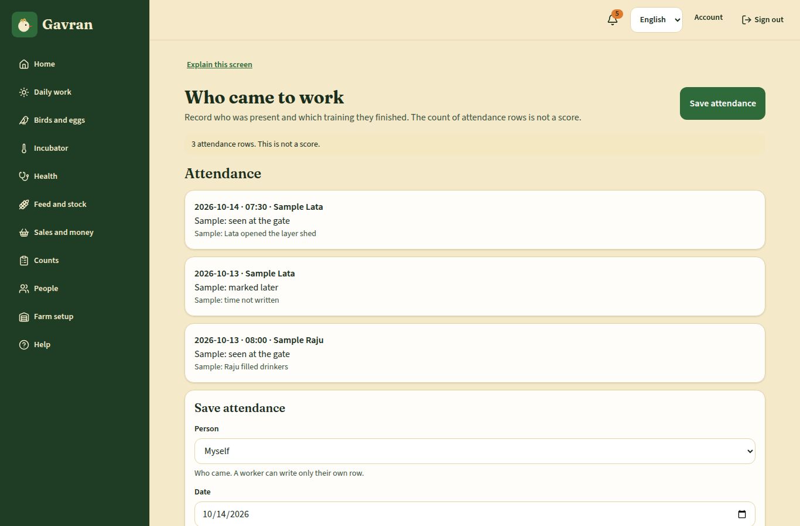

**What it is.** A note of who was on the farm, and training they finished.

**Where it is.** Daily work, then Who came to work.

**Why it is used.** So you remember attendance without a score or a mark.

**How to use it.**

1. Pick the person and the day.
2. Leave the clock blank if you do not use one.
3. Training is lower on the same screen.

## Messages

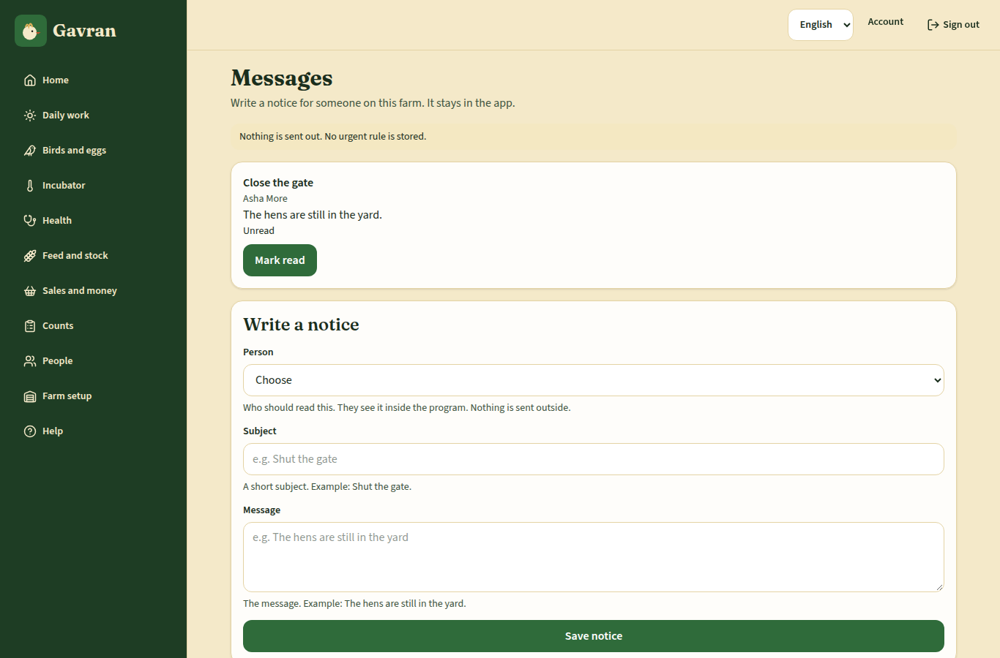

**What it is.** A note from one person on the farm to another. It stays in this program.

**Where it is.** Daily work, then Messages.

**Why it is used.** So a worker sees a message without a separate letter or a call from the program.

**How to use it.**

1. Choose the person, write a subject and a message, and save.
2. They open Messages and mark it read.

## Flocks

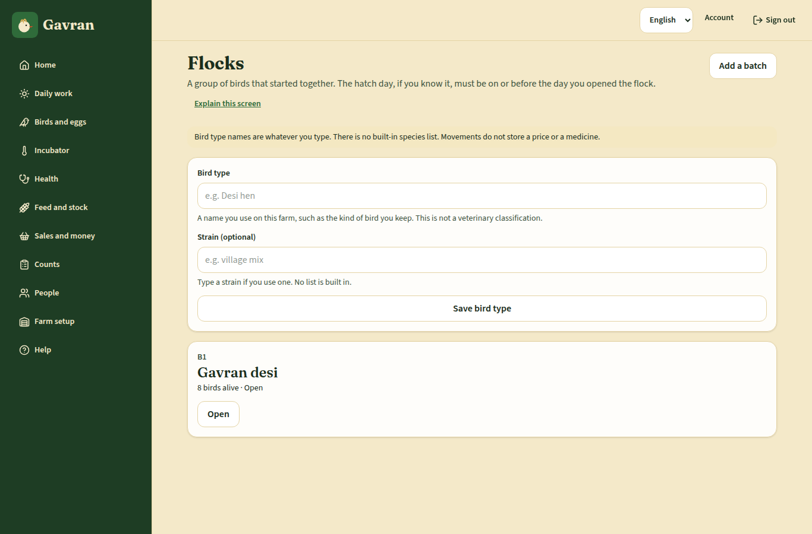

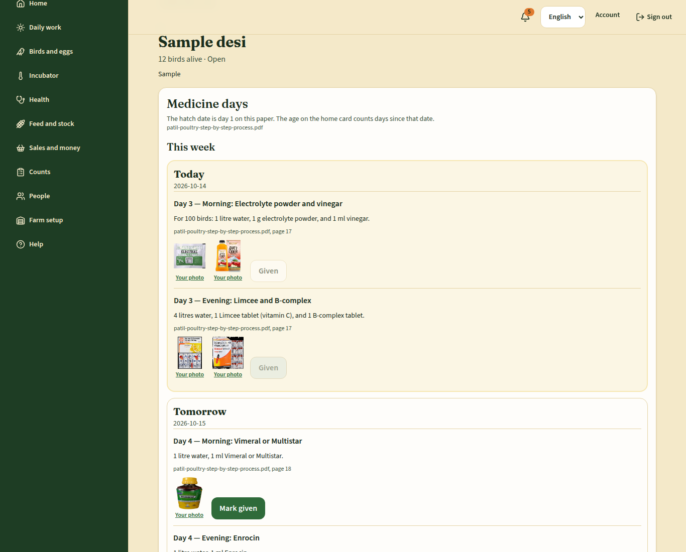

**What it is.** A group of birds you started on one day, in one shed. The flock page also lists the chick-day medicine paper.

**Where it is.** Birds and eggs, then Flocks.

**Why it is used.** So later eggs, deaths, and feed can point at the right birds.

**How to use it.**

1. Save a bird name first.
2. Then add a flock: a short code, the shed, how many birds, the day it opened, and the hatch day if you know it.
3. The hatch day cannot be after the opened day. On the medicine paper, that date is day 1.
4. Open the flock. Medicine days lists today, tomorrow, and this week. Tick **Mark given** after you give that line. The words and amounts are copied from the chick-day paper. One line has no day and no amount; it says to check with the vet.
5. The first time, write a short note that you checked the paper. Until then, a tick is refused. The sample farm is already marked checked, and the note starts with Sample.
6. Each medicine has a picture from that paper, or a plain bottle, powder, or drop drawing. You can add your own photo. The page tries to clear a white background. If it cannot, it keeps the photo as it is.

## Eggs

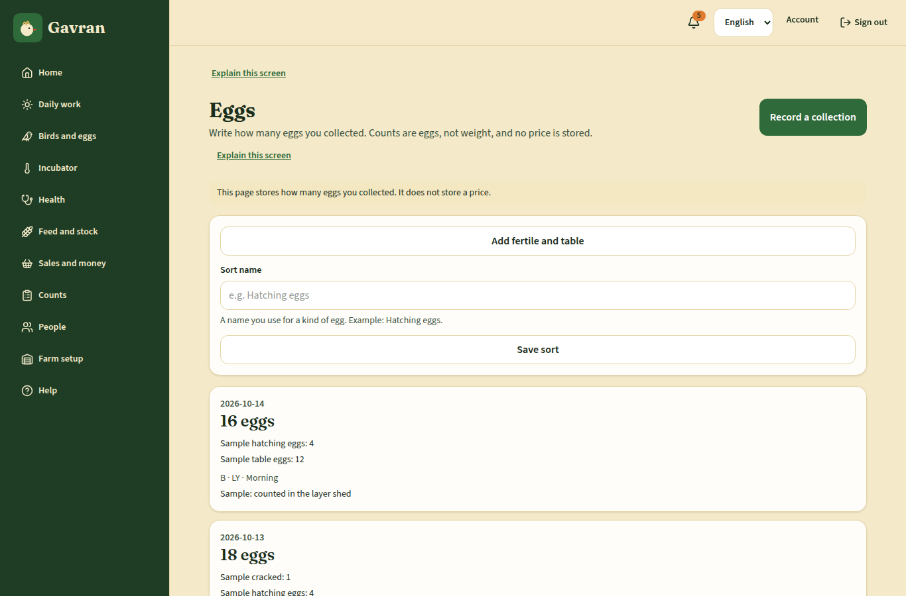

**What it is.** How many eggs you collected, split by the names you use, such as eating eggs or hatching eggs.

**Where it is.** Birds and eggs, then Eggs. Today also links here.

**Why it is used.** So you know what the hens gave each day. No price is stored.

**How to use it.**

1. Add the sort names you use.
2. Then record a day, optional flock and shed, and a count for each sort.

## Birds lost

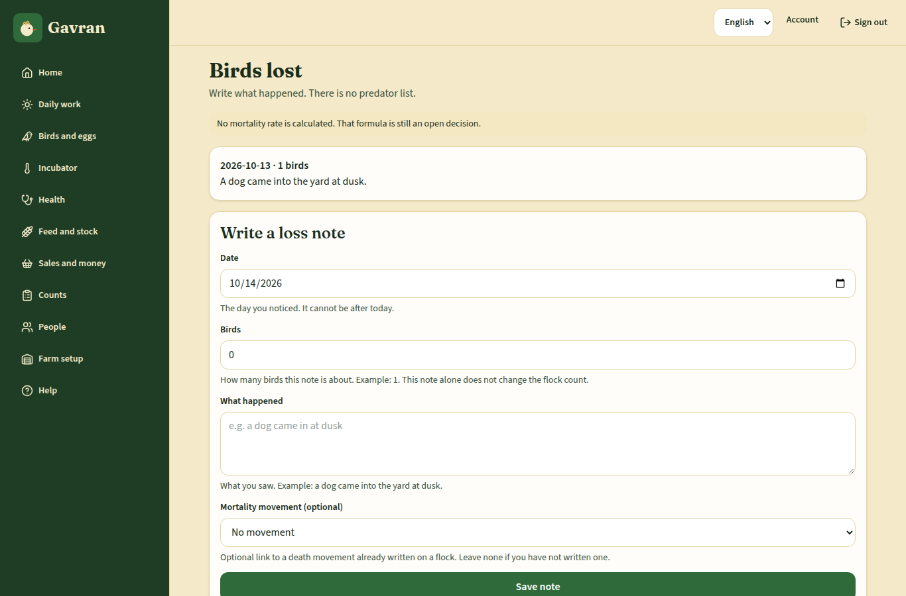

**What it is.** A note of birds that died or were taken by an animal, in your own words.

**Where it is.** Birds and eggs, then Birds lost.

**Why it is used.** So you remember what happened. No death rate is calculated.

**How to use it.**

1. Write the day, what happened, and how many.
2. You can point at a death already written on a flock.

## Parents

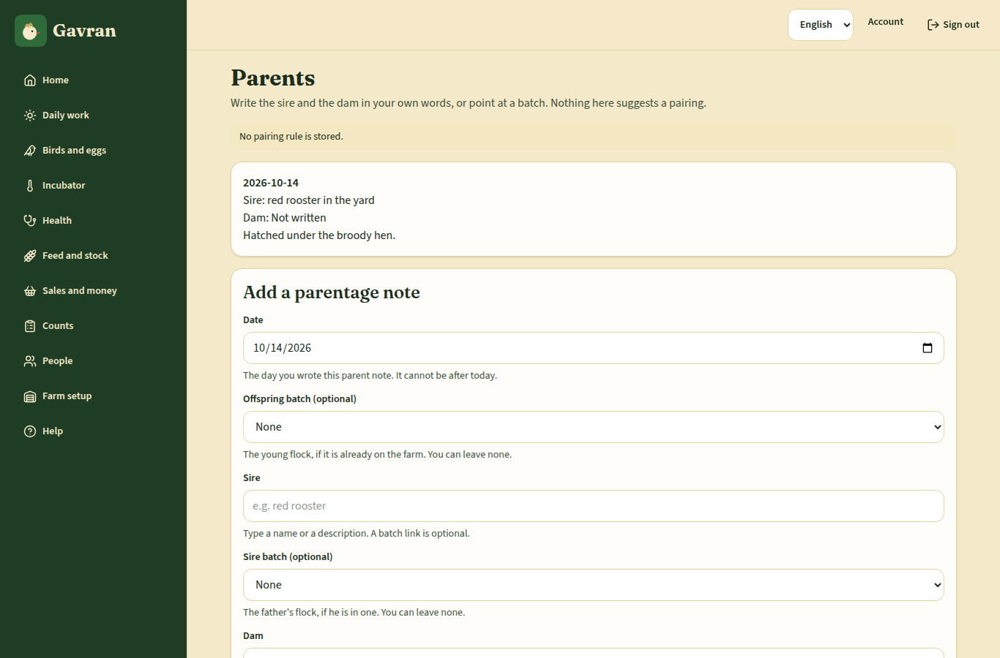

**What it is.** Which birds you believe are the father and mother of a flock.

**Where it is.** Birds and eggs, then Parents.

**Why it is used.** Desi flocks are often bred at home. This only stores what you write. It does not suggest a pair.

**How to use it.**

1. Pick the young flock, write the father and mother in words, and optionally point at their flocks.

## Incubator machines

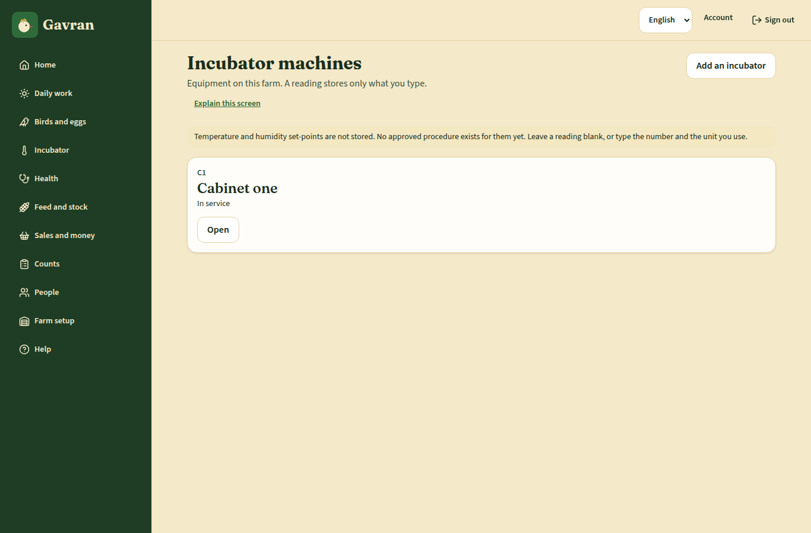

**What it is.** The machines you own. A reading is only the numbers you type.

**Where it is.** Incubator, then Incubator machines.

**Why it is used.** So temperature and care notes stay with the right machine. There is no target temperature built in.

**How to use it.**

1. Add the machine with a name you know.
2. Open it to write a temperature or a repair, only if you measured it.

## Eggs set to hatch

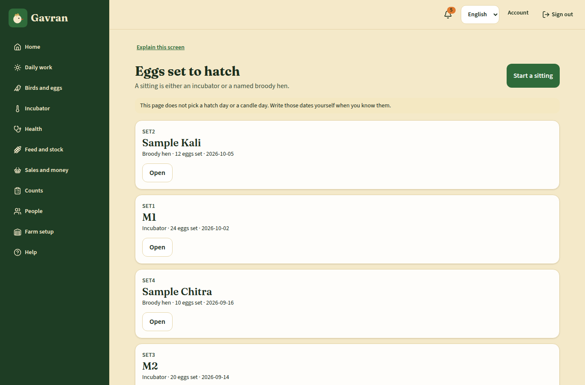

**What it is.** A set of eggs under a machine or under a broody hen you name.

**Where it is.** Incubator, then Eggs set to hatch.

**Why it is used.** Desi farms hatch with a hen or a machine. The program does not guess the hatch day.

**How to use it.**

1. Start a sitting, choose machine or hen, and the day.
2. Open it to candle or to write how many chicks came out.

## Sick birds and medicines

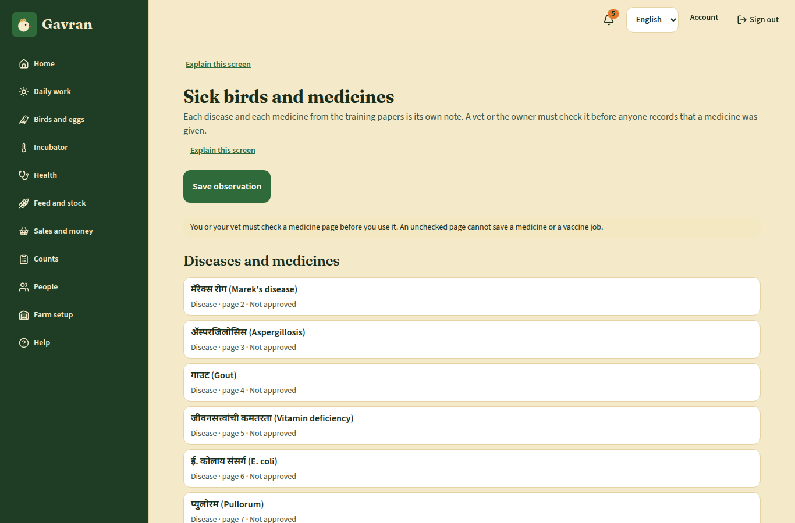

**What it is.** Diseases and medicines copied from the Patil training papers, plus what you saw on the farm.

**Where it is.** The Health tile.

**Why it is used.** So a worker can read a named disease. A medicine note stays locked until the owner or a vet writes that they checked it.

**How to use it.**

1. Open a name.
2. Read what it is for, the signs, how it was written to give, and the caution.
3. Do not treat from an unchecked note.

## Feed and stock

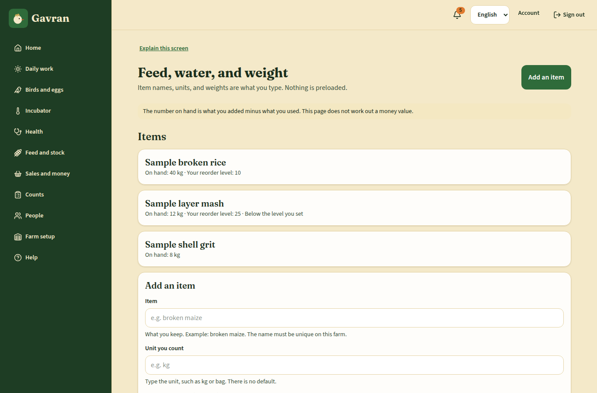

**What it is.** Feed, water, and weights you type. Nothing suggests a formula.

**Where it is.** The Feed and stock tile.

**Why it is used.** So you see what came in and what the birds ate.

**How to use it.**

1. Add an item in your own words, such as bajra or a mash you mix.
2. Then write a quantity in or out.

## Sales

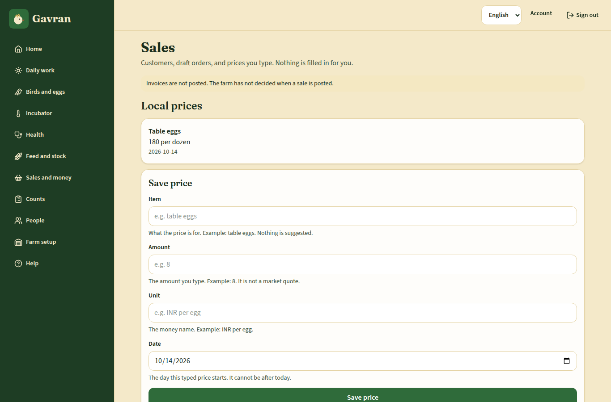

**What it is.** Customers, what they ordered, and prices you type yourself.

**Where it is.** Sales and money, then Sales.

**Why it is used.** A local market price is only what you last wrote. Nothing is filled in.

**How to use it.**

1. Add a customer.
2. Write a price when you want one.
3. Then write an order with what left the farm.

## Money in and out

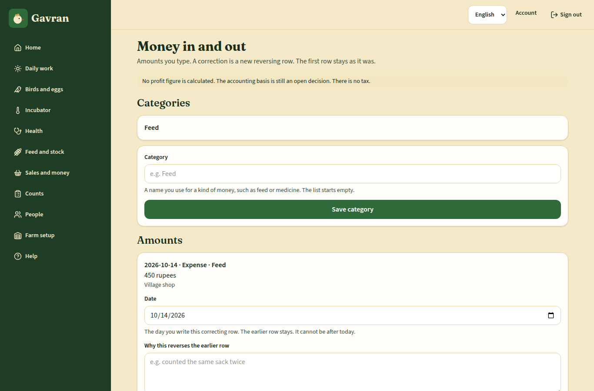

**What it is.** Money you spent or received, with the unit you type, such as rupees.

**Where it is.** Sales and money, then Money in and out.

**Why it is used.** So the farm notebook has a line for each amount. A correction is a new line. The old line stays.

**How to use it.**

1. Add a heading such as feed or medicine.
2. Then write the day, in or out, the amount, and the unit.

## Shops you buy from

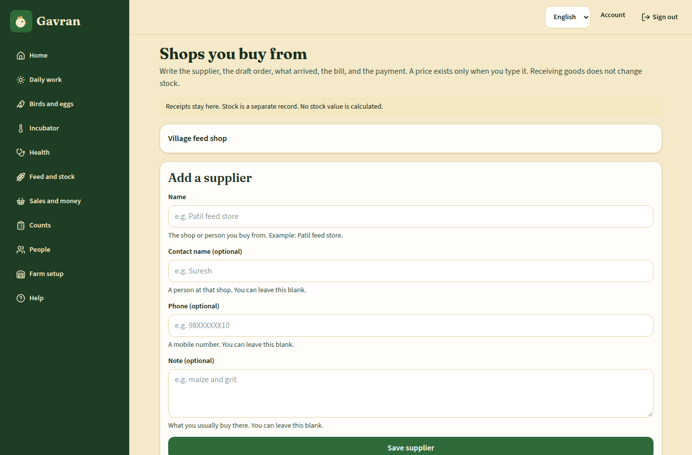

**What it is.** People you buy feed or birds from, what you ordered, what arrived, and what you paid.

**Where it is.** Sales and money, then Shops you buy from.

**Why it is used.** A delivery note does not add feed to stock by itself. You still write stock separately.

**How to use it.**

1. Add the shop.
2. Write an order, then what you accepted, then a bill or a payment if you want those lines.

## Buyer bills

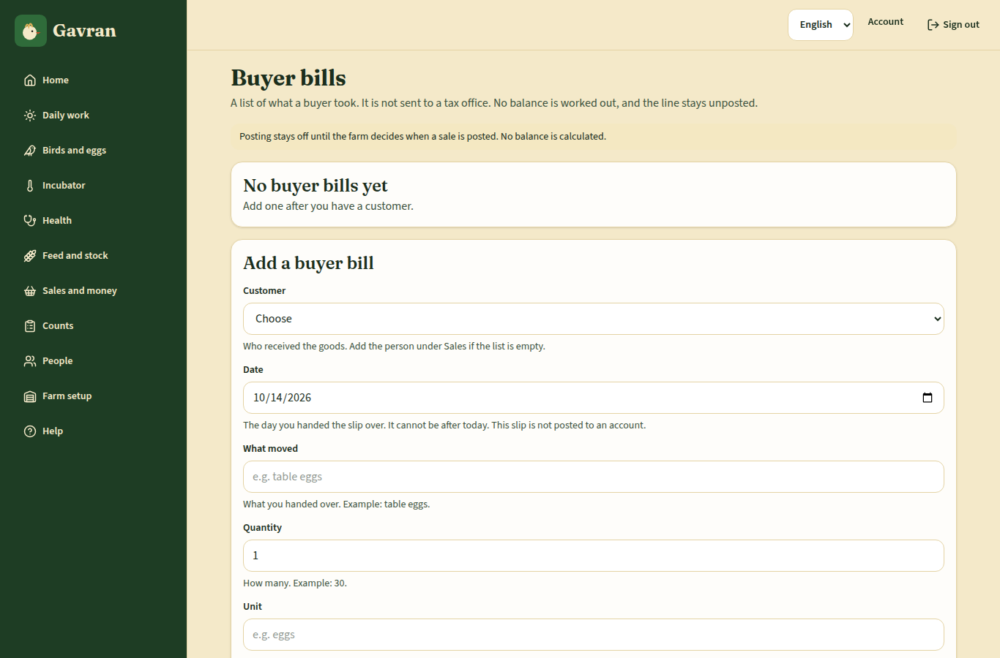

**What it is.** A paper list of what a buyer took. It is not sent to a tax office, and no balance is worked out.

**Where it is.** Sales and money, then Buyer bills.

**Why it is used.** So you can read back a sale. Posting into accounts is still not decided, so the line stays unposted.

**How to use it.**

1. Pick a customer and a day.
2. Write what moved.
3. Leave the price blank if you are not writing one.
4. A return is a new line.

## Counts

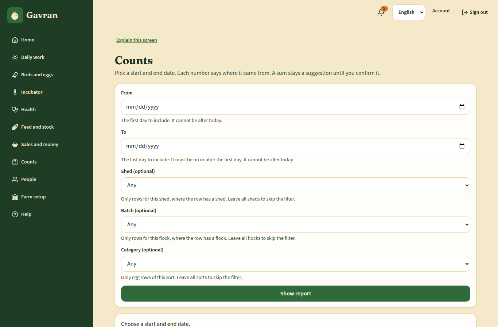

**What it is.** Totals for the dates you choose, such as eggs collected.

**Where it is.** The Counts tile.

**Why it is used.** So you can look back over a week or a month. A rate stays marked as proposed until you decide the formula.

**How to use it.**

1. Pick a start day and an end day.
2. The end day cannot be after today.
3. Optional filters narrow a shed, flock, or egg sort.

## People

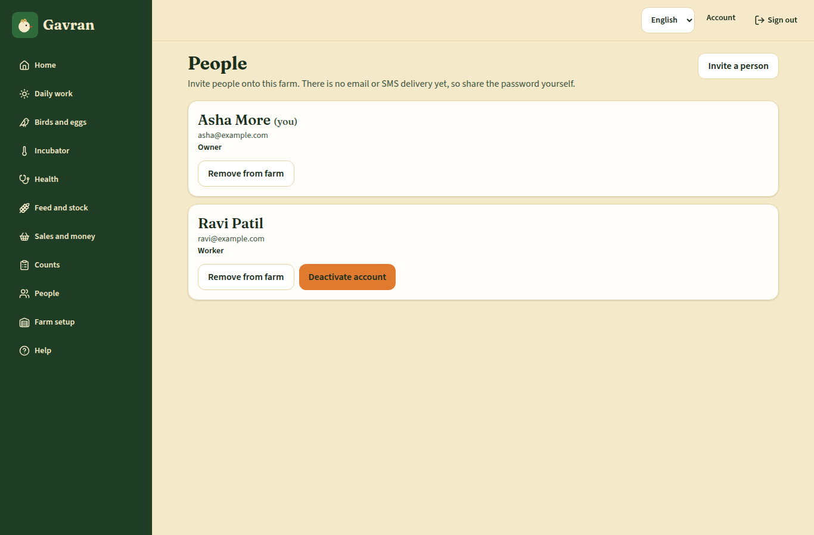

**What it is.** Who may open this farm, and what they may change.

**Where it is.** The People tile. A worker does not see this tile.

**Why it is used.** So each person has their own sign-in. Nothing is sent; you tell them the mobile number and the PIN yourself.

**How to use it.**

1. For a worker, write the name, the mobile number, and a PIN of four to six digits, then tell them that PIN.
2. A mail address and a long secret phrase remain for the owner and a manager.
3. Owner sees everything.
4. A worker sees daily jobs, birds, hatch, health, and feed.

## Farm details

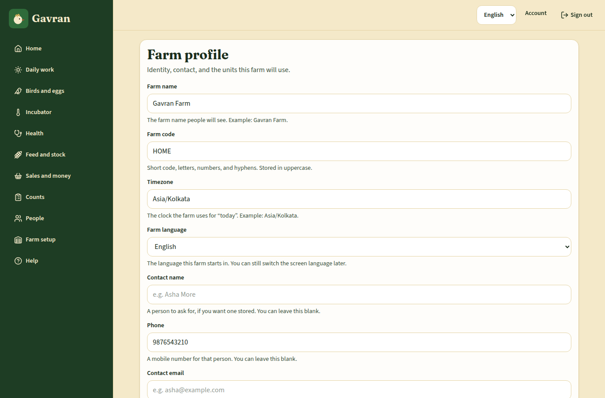

**What it is.** The farm name, place words, and whether you weigh in kilograms or grams.

**Where it is.** Farm setup, then Farm details.

**Why it is used.** The clock of the farm decides which day is today for dates.

**How to use it.**

1. Open the form.
2. Change the name or the time zone, such as Asia/Kolkata, and save.
3. A worker can read this but not change it.

## Sheds

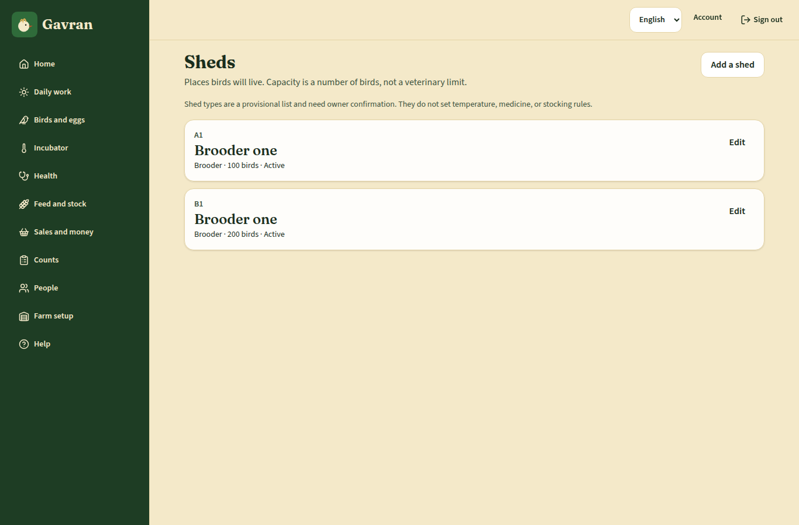

**What it is.** Houses and pens, with how many birds you say can stand there.

**Where it is.** Farm setup, then Sheds.

**Why it is used.** A new flock must start in a shed that is in use.

**How to use it.**

1. Add a short code, a name, the kind of house, and a bird count you choose.
2. That count is your limit, not a rule from a book.

## Papers and photos

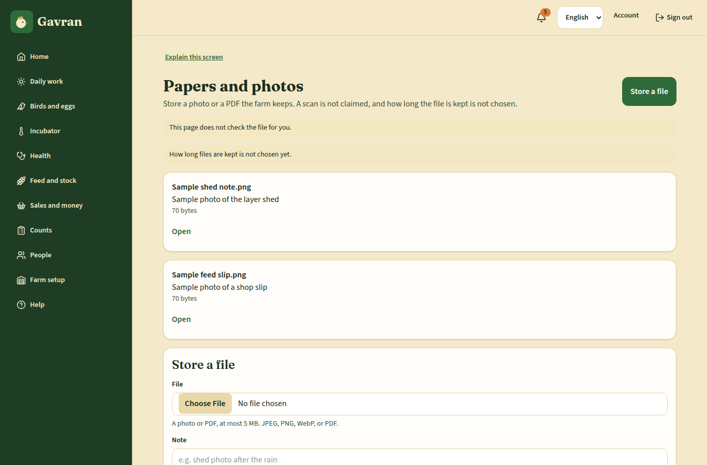

**What it is.** A photo or a PDF you keep, such as a bill photo or a bird photo.

**Where it is.** Farm setup, then Papers and photos. Workers do not see this.

**Why it is used.** So a paper is next to the farm record. How long it is kept is not decided.

**How to use it.**

1. Choose a JPEG, PNG, WebP, or PDF under 5 MB and a short note.

## Saved count names

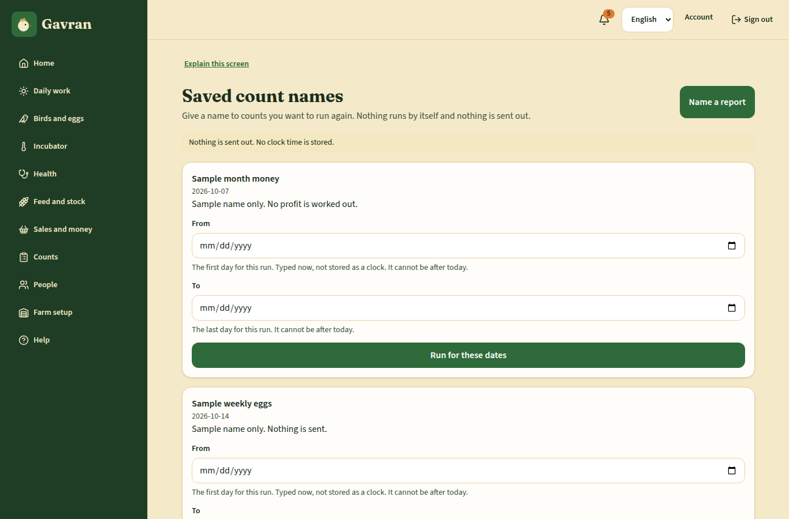

**What it is.** A name you give to a count you run again later. Nothing runs by itself and nothing is sent.

**Where it is.** Farm setup, then Saved count names.

**Why it is used.** So you remember a report you like, without a clock.

**How to use it.**

1. Type a name, a note, and the day you named it.
2. When you want numbers, type a start and end then.

## Spare copy

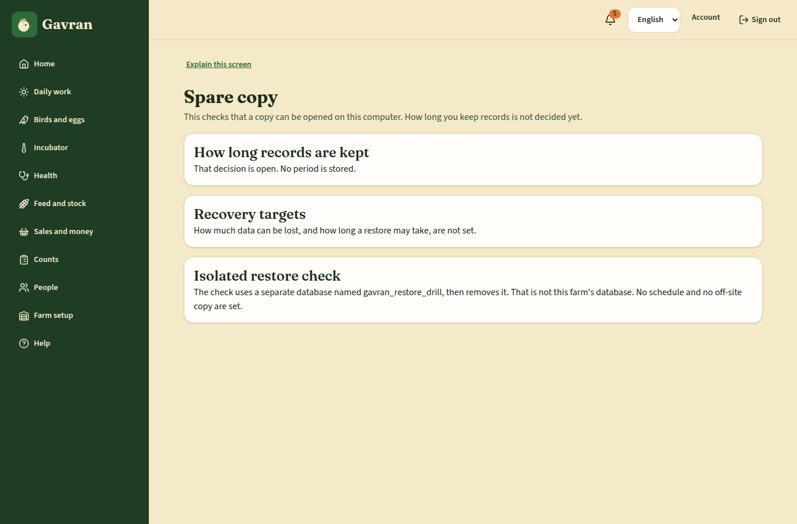

**What it is.** A check that a copy of the records can be opened on this computer. It is not a backup sitting somewhere else.

**Where it is.** Farm setup, then Spare copy. Only an owner or manager sees it.

**Why it is used.** How long to keep records, and how much loss is acceptable, is still not chosen.

**How to use it.**

1. Read the open questions.
2. Run the check only when you mean to test a restore on a separate practice database.

## Saved on this phone

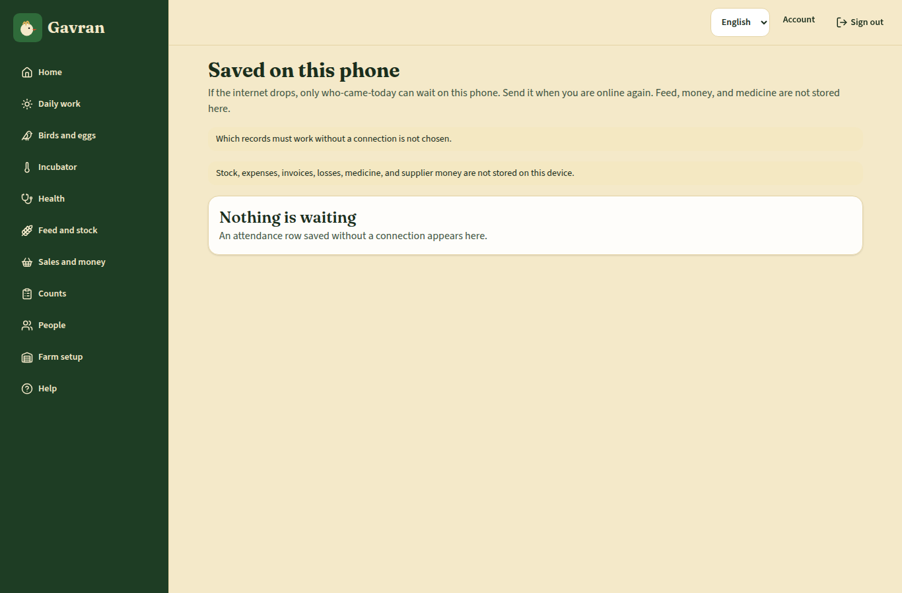

**What it is.** Attendance written while the internet was down. It waits here until you send it.

**Where it is.** Farm setup, then Saved on this phone.

**Why it is used.** Only who-came-today can wait on the phone. Feed, money, deaths, and medicine are not stored offline.

**How to use it.**

1. When the internet is back, open this screen and tap Send.
2. If the farm already has that row, it stays as a conflict and is not merged.

## Find a record

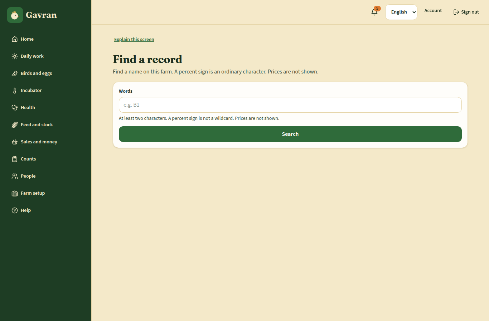

**What it is.** Look for a name you typed, such as a flock code or a customer.

**Where it is.** Farm setup, then Find a record.

**Why it is used.** A short way to jump to a record. Prices are not shown in the results.

**How to use it.**

1. Type at least two letters.
2. A percent sign is just a percent sign.

## Who changed what

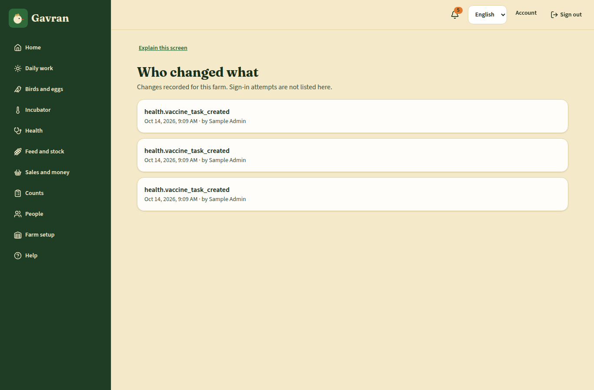

**What it is.** A list of changes on this farm. Sign-in attempts are not in this list.

**Where it is.** Farm setup, then Who changed what.

**Why it is used.** So you can see who added a flock or a payment.

**How to use it.**

1. Open the list and read the newest lines first.

## What this book does not do

It does not invent a dose, a price, a hatch day, or a tax rule. A buyer slip stays unposted. A yard note does not suggest a clock time. Medicine pages stay unused until the owner checks them against the paper.
